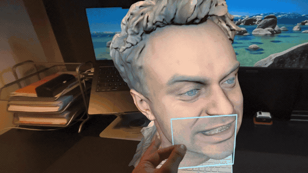
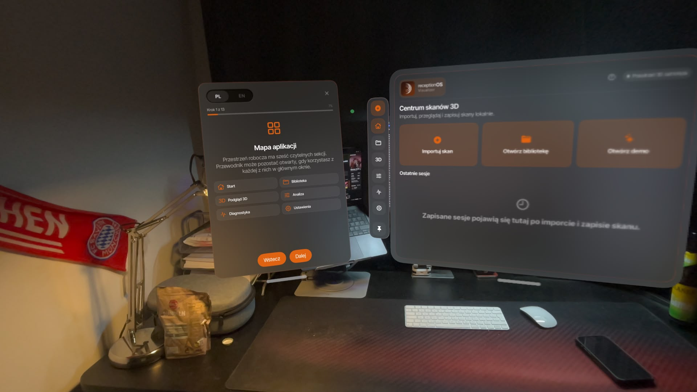
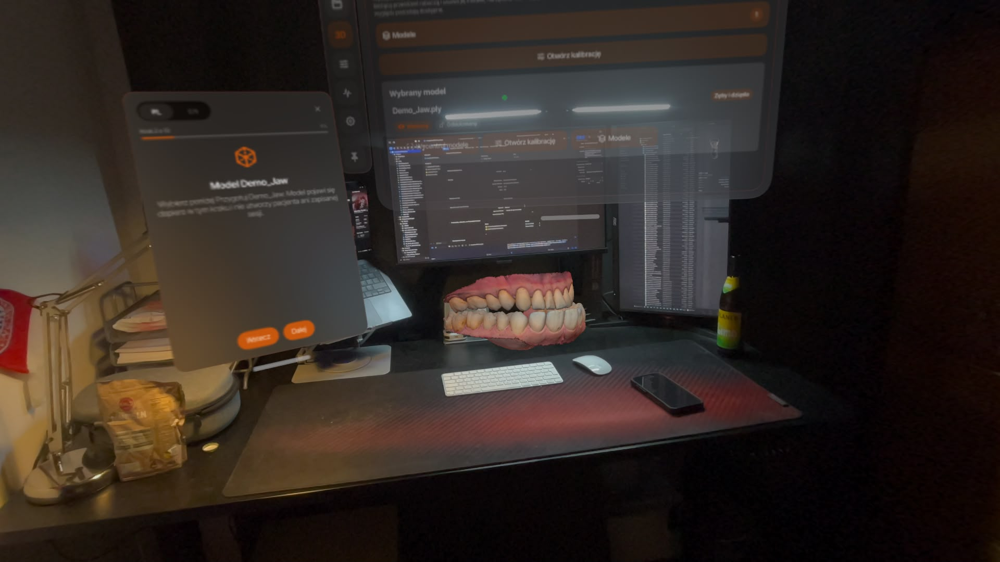
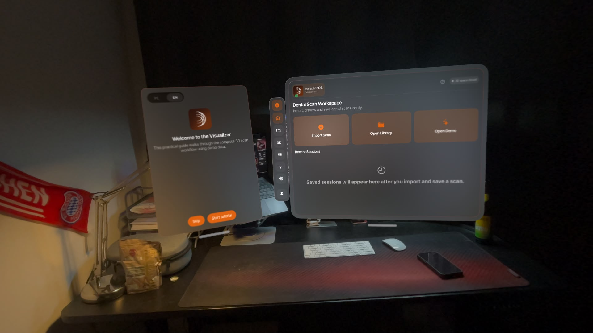
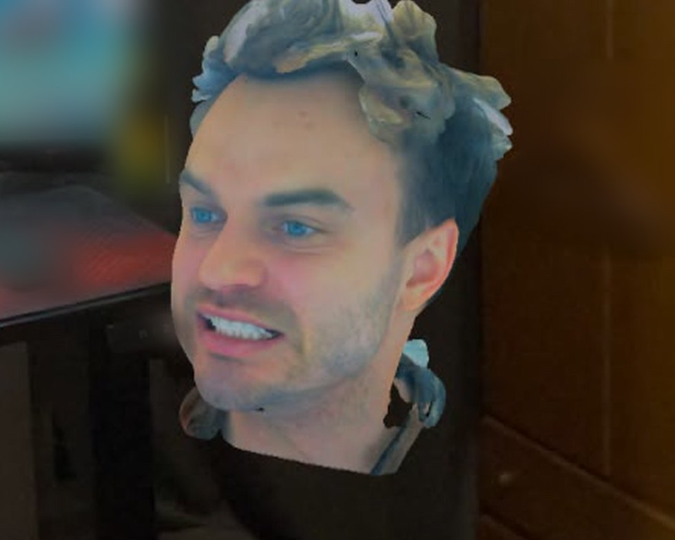
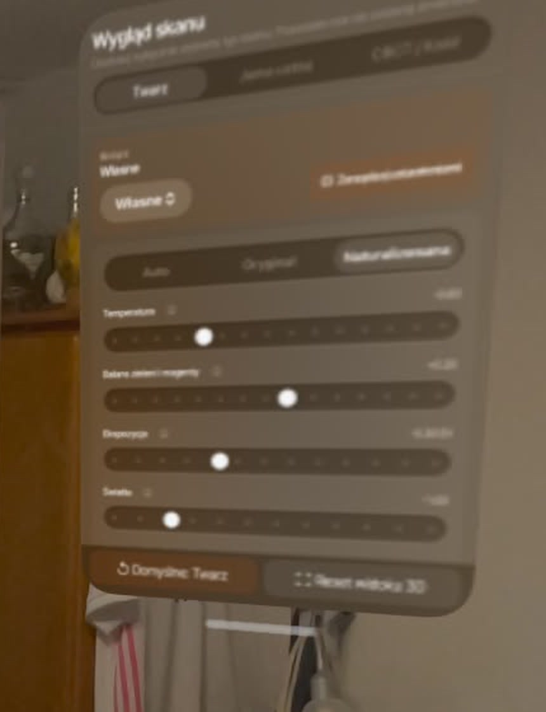
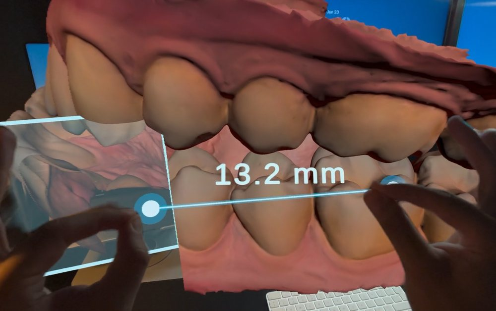
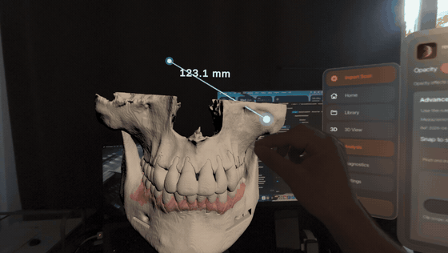
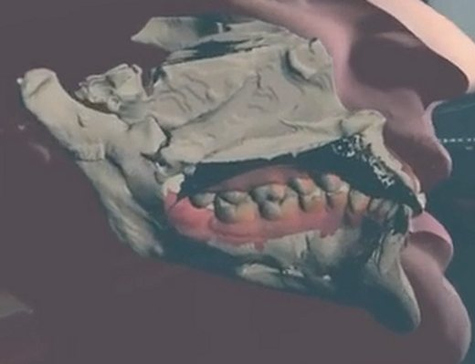
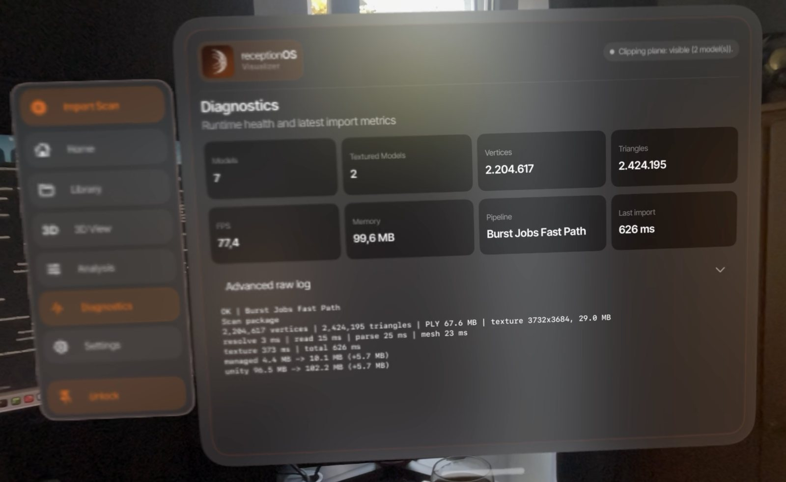

# receptionOS Visualizer

An XR app that puts a patient's face scan, jaw scans and CBCT into one aligned 3D scene at true scale, to explore by hand on the headset: grab any part, see through layers or cut them open, correct the colour and measure on the scan surface. Everything runs on the device. I built it for [receptionOS](https://receptionos.com/) as a SwiftUI and Unity hybrid.

`visionOS` · `SwiftUI` · `Unity 6` · `C#` · `URP` · `Metal` · `IL2CPP` · `arm64`

| My role | Platform | Delivered | Public scope |
|---|---|---|---|
| End-to-end product architecture, native integration, Unity runtime, rendering, spatial tools and release stabilization | Apple Vision Pro | `2.1.5 / Build 155`, accepted on physical hardware | Architecture, engineering decisions and recordings from the device (the app's source stays with receptionOS) |

*A see-through window from the face scan into the CBCT, pulled past the jaw, on the headset.*

## In short

- **The problem.** receptionOS had a patient's face scan, jaw scans and CBCT, and a headset, but no way to see them together in 3D, work with them by hand or measure across them.
- **My part.** I took the app on my own from an early proof of concept to the release delivered to receptionOS: the architecture, the native SwiftUI shell, the Unity runtime, rendering, the spatial tools and the release work.
- **The result.** Version 2.1.5, build 155, was accepted on the physical headset. Up to 10 scans with up to 3 million triangles each load into one aligned scene that keeps the patient's real proportions. Any part can be grabbed and turned by hand, layers can be made see-through or cut with a clipping plane, the face texture is mapped to look photorealistic, without the scanner's colour casts, and a ruler measures on the scan surface. Patient sessions are kept in a database on the headset, and nothing needs the internet.
- **The evidence.** The screenshots and recordings on this page come from the headset, and [a code sample from the app](code/scene-lifecycle) has seven tests that run in CI. The app's source stays private with receptionOS.

## What shipped

receptionOS already had the scans and the headset but no workflow to use them together. I took receptionOS Visualizer on my own from an early proof of concept to the app delivered to them.

It imports scanner-derived files locally and rebuilds aligned multi-model compositions. Face, oral-scan and CBCT data each go through their own role-specific render path. What the app does:

- local PLY, texture and alignment-sidecar import
- multiple visible models in one aligned spatial composition
- semantic roles for Face, upper jaw, lower jaw and CBCT
- role-aware rendering and bounded calibration
- native multi-window inspection, model management and onboarding
- a patient library on the headset: dated sessions that save the aligned scene so it can be reopened later, with checksum-verified files
- geometry-level surface snapping and cross-model measurement
- deterministic sync between the native shell and the Unity runtime
- Polish and English product UI

| Native product shell | Import and role assignment | Spatial onboarding |
|---|---|---|
|  |  |  |

These were captured on the physical headset. Acceptance was decided on the device.

## On-device workflows

### Photorealistic face texture and calibration

| The face scan with the new photorealistic texture mapping | The calibration controls on the headset |
|---|---|
|  |  |

I took the face texture and its mapping onto the scan to a new level of quality, so on the headset the face looks photorealistic.

Scanner textures can come in with a strong color cast. The accepted renderer keeps the original appearance available and calculates bounded statistics for the imported scan. It applies naturalization per pixel on the GPU instead of baking a new atlas on the CPU. The user can switch between Auto, Original and Naturalized modes and then make bounded manual corrections to temperature, tint, exposure and tonal response.

The correction stays visible and can be undone. It isn't presented as anatomical segmentation and it doesn't silently rewrite the source texture.

### Cross-model surface measurement

Each ruler endpoint snaps independently to the closest eligible triangle surface. In an aligned composition the endpoints can belong to different models and the distance is still expressed in one shared source-scale context. The runtime keeps track of both attached surfaces and invalidates the measurement when its composition context breaks.

*Measuring on a jaw from a CBCT scan, on the headset.*

### Spatial inspection and direct model interaction

The user can move between a close look at a surface and the whole aligned composition. Hand interaction, model state and the native windows stay in one workflow.

### Aligned Face, jaw and CBCT composition

The Face surface, the jaws and the CBCT-derived geometry are all separate files. Their shared scale and optional alignment transforms have to stay meaningful after import. If they don't, an overlay can look plausible and still be spatially wrong.

## Three architectures

The architecture changed as the requirements became clearer. It started as a native visionOS and RealityKit proof of concept. Then it went through a Unity plus PolySpatial bounded-volume prototype and ended up as a production hybrid. PolySpatial sped up early spatial iteration. But the delivered system needed a native product shell and direct control over large-mesh processing, shaders and lifecycle.

Each change came from a concrete constraint:

1. **Native Swift and RealityKit prototype:** proved out the interaction concept on the headset and the local-file workflow.
2. **Unity plus PolySpatial prototype:** made it faster to experiment with spatial interaction and bounded volumes.
3. **SwiftUI plus Unity URP/Metal hybrid:** kept native product concerns apart from the high-control 3D runtime that imported scan data needs.

## Why the app is a hybrid

I gave each layer a clear owner.

- **Swift 6 and SwiftUI** own the native windows, Files integration, localization, privacy-facing UI and the visionOS lifecycle.
- **Objective-C++ and JSON** make up a versioned command-and-state protocol between the native shell and Unity.
- **Unity 6000.3.19f1 and C#** own import, semantic model state, transforms, spatial tools and rendering logic.
- **URP and Metal** are the real-time graphics path on the device.
- **IL2CPP** turns managed Unity assemblies into C++ for ahead-of-time arm64 deployment through Apple's toolchain.

Every operation over the bridge carries a request identity and completes through a terminal acknowledgement, postcondition checks and a published state snapshot. Startup commands get queued until the runtime is ready, and stale lifecycle effects can't change a newer scene.

## Main technical problems

### 1. Scanner interoperability

The importer handles ASCII and binary little-endian PLY. That includes positions, triangles, normals, vertex colors and texture coordinates. It also takes external PNG or JPEG appearance data and optional `.matrix4` alignment sidecars.

Import is a validation pipeline. Geometry, appearance data, role metadata and optional alignment sidecars all get checked before any expensive mesh allocation. Then everything gets published into one deterministic model state. The accepted limits include 512 MB per input file, 1.5 million vertices, 3 million triangles and 10 models in one workspace.

### 2. Role-aware rendering

A Face scan, an oral scan and CBCT-derived geometry each need their own rendering assumptions.

- **Face rendering** keeps the source texture information intact while applying bounded color statistics and GPU-side naturalization.
- **Oral rendering** combines scanner color with controlled cavity, depth, ambient-occlusion and material response.
- **CBCT rendering** has its own profile so later calibration can't silently change the accepted bone baseline.

Three experimental tooth-color controls stay disabled because the available color mask isn't scanner-independent anatomical segmentation. They looked right on one scan but could change gingiva or artifacts on another, so the accepted visual baseline stays as it is.

### 3. Shared scale and measurement

The ruler works on the imported triangle surfaces and doesn't use model origins or bounding boxes. A BVH speeds up the closest-point queries. Each endpoint remembers which model surface it's attached to, and each reading says whether the alignment behind it is verified.

For a standalone model the distance is measured in that model's source-space context. In an aligned composition every eligible model shares one measurement context. So one point can attach to a tooth and the other to a separate Face surface. Neither point has to go through the transform of whichever model is active.

## Problems found on the device

Several problems passed in the simulator and only showed up on the physical headset.

- **Build 149, Face-processing watchdog:** a full CPU atlas correction blocked long enough to trigger the visionOS watchdog. The accepted path bounds the CPU statistics and moves per-pixel naturalization to the GPU.
- **Build 151, lifecycle race:** a native window and a singleton Unity runtime produced stale startup completions. Reducer-style state with explicit run and effect identity made startup and reconnection deterministic.
- **Visual-baseline regression:** a later rendering improvement changed a CBCT appearance that had already been accepted. The accepted zero-settings appearance from V7 / Build 148 was frozen as visual regression evidence. That way later features couldn't silently redefine the baseline.

Each of them led to a change in the architecture.

## Validation and delivery evidence

The accepted release had **36,115 authored lines** across Swift, Objective-C++, C#, shaders and tests. That number leaves out generated and exported code.

Validation included:

- **101 Unity EditMode tests** and **33 PlayMode tests**
- Swift 6 / XROS strict compilation
- clean fail-closed Unity-to-Xcode export
- unsigned and signed builds
- codesign, plist, target-membership, multi-scene and privacy checks
- acceptance of the exact build on the physical headset

*The diagnostics window on the headset with seven models loaded. The last import had 2,424,195 triangles and took 626 ms, and the app ran at 77.4 frames per second.*

## Relevance to immersive research systems

When an XR app is used in a study, scene state, coordinate scale, rendering baselines and device performance can change what gets measured. This app has deterministic lifecycle state, explicit spatial semantics, fixed visual references and profiling on the physical device. It's a visualization product and no perception experiment was run with it.

## Code sample

The scene-lifecycle reducer from the Build 151 fix is in [`code/scene-lifecycle`](code/scene-lifecycle): a small Swift package with seven tests and the example of how the app plugs it into Unity. It keeps the app's single Unity runtime from pausing when focus moves between the native windows. The tests run on GitHub's macOS machines on every change:

## Scope and confidentiality

receptionOS agreed to be named here and to the recordings on this page. The face in the recordings is a friend's demonstration scan, shown with consent. This repo contains no patient data, raw private scans, clinical records, exported Xcode project, signing material or confidential release assets. The only application source is the small code sample in `code/scene-lifecycle`.

I describe the product as a local-first spatial visualization system. No medical-device certification, diagnostic-accuracy or clinical-outcome claim is made.
